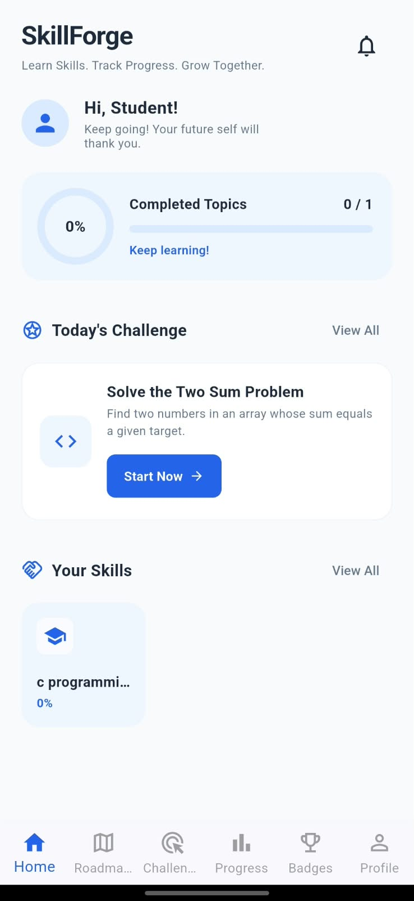
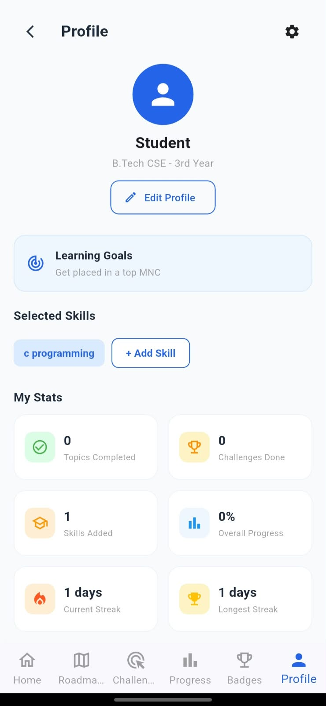
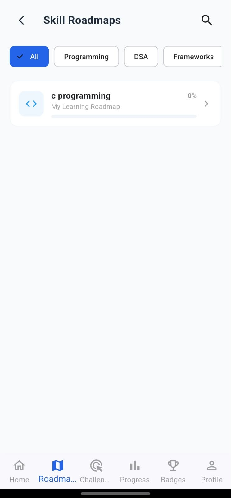

# SkillForge – Personal Skill Learning App

## About
SkillForge is a Flutter-based mobile application designed to help students learn new skills, explore learning roadmaps, and track their progress.

**Topic:** Personal Skill Learning Application

## Features
- Home Screen
- Skill Roadmaps
- Search Skills
- Learning Progress
- Daily Challenges
- Profile Management
- Settings
- Local Data Storage

## Technologies Used
- Flutter
- Dart
- Provider
- SharedPreferences
- Material Design

## Project Structure
```text
lib/
├── models/
├── providers/
├── services/
├── screens/
├── widgets/
├── theme/
└── main.dart
```

## Screenshots

### Home Screen


### Profile Screen


### Roadmaps Screen


## Data Source
The application uses local learning content. SharedPreferences stores user information and learning progress on the device. Provider manages shared application state.

## Installation and Setup

### Prerequisites
- Flutter SDK 3.35 or newer
- Dart SDK
- Android Studio
- JDK 17
- Android device or emulator

### Steps to Run

Clone the repository:

```bash
git clone https://github.com/mukeSh-2492006/skillforge.git
```

Open the project:

```bash
cd skillforge
```

Install dependencies:

```bash
flutter pub get
```

Run the application:

```bash
flutter run
```

## Testing

```bash
flutter analyze
flutter test
```

## Release APK

Build the APK:

```bash
flutter build apk --release
```

APK Location:

`build/app/outputs/flutter-apk/app-release.apk`

## Defect Log

| ID | Defect | Steps to Reproduce | Status |
|---|---|---|---|
| D-01 | Challenges UI error | Open Challenges screen | Fixed in code |
| D-02 | Roadmap UI error | Open Roadmaps screen | Fixed in code |
| D-03 | Category filter issue | Select a roadmap category | Fixed |
| D-04 | Search issue | Search for a skill | Fixed |
| D-05 | Profile navigation issue | Open Profile and select Settings | Fixed |
| D-06 | Home data issue | Update skill progress and open Home | Fixed in code |
| D-07 | Profile editing issue | Edit and save profile details | Fixed |
| D-08 | Roadmap list states issue | Test loading, empty and error states | Fixed in code |

## Team Contributions

| Team Member | Roll Number | Contribution |
|---|---|---|
| Sami Mukesh | 248X1A05Q4 | Core Flutter application development, UI implementation, feature integration, defect fixes, testing, and release APK generation. |
| Shaik Abdul Samad | 248X1A05Q8 | Updated SkillForge branding across Home, Help & Support, and Settings screens. |
| Talakayala Rakesh | 248X1A05T0 | Assigned contribution; completed work and implementation details to be updated after verification. |

## GitHub Repository

https://github.com/mukeSh-2492006/skillforge

**Branch:** main

---

**SkillForge – Learn Skills. Track Progress. Grow Every Day.**
