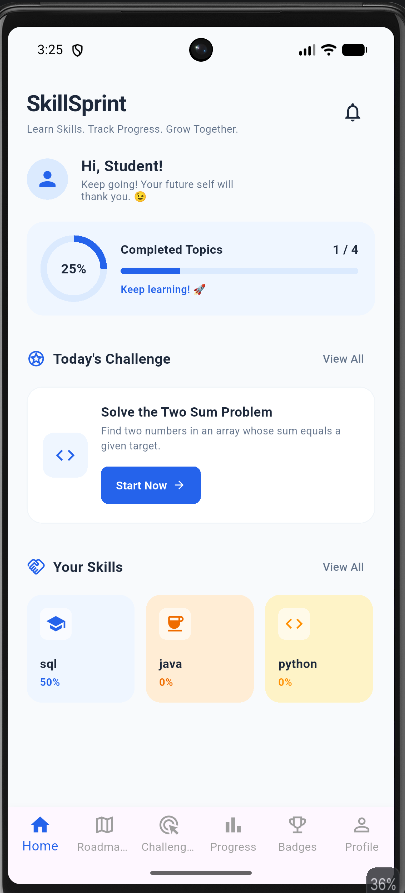
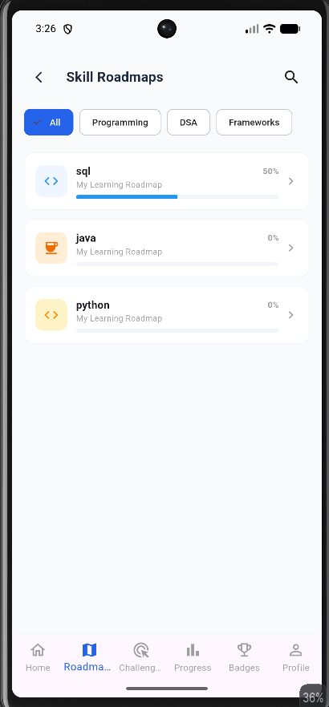

# SkillSprint

**SkillSprint** is a Flutter-based Android learning companion that helps students create skill roadmaps, add and complete learning topics, practise coding challenges, and track their progress.

> **Project topic:** Skill learning and progress tracking application. Confirm that the faculty's approval of this topic is documented before final submission, because it is not named in the approved-topic list in the supplied project specification.

## Features

- **Home:** Shows learning progress, an available challenge, and the student's saved skills.
- **Roadmaps:** Create and manage skill roadmaps, add topics, mark topics complete, filter by category, and search by skill name.
- **Challenges:** Browse challenges by category and difficulty, view challenge details, mark challenges complete, and add custom challenges.
- **Progress:** Displays topic completion and overall learning progress.
- **Achievements:** Unlocks badges based on learning and challenge activity.
- **Profile:** Stores the student's name, branch, year, college, and learning goal locally; displays learning statistics and streaks.
- **Settings and Help:** Saves the learning-reminder preference and provides in-app FAQs.

## Technology

- Flutter and Dart
- Provider (`ChangeNotifier`) for shared application state
- `shared_preferences` for local persistence
- Material widgets for the Android user interface

## Data storage

Student-created skills, topics, topic-completion states, custom challenges, challenge-completion states, profile details, streak information, and the reminder preference are stored locally on the device using `SharedPreferences`.

The current app also contains a built-in challenge catalogue. Review this against the project specification's rule that hard-coded sample lists are not accepted in the final version, and document/obtain faculty acceptance or change the challenge catalogue before submission if required.

## Requirements

- Flutter stable 3.35 or newer
- Android SDK / Android Studio with Flutter and Dart plugins
- JDK 17 or newer as required by the installed Flutter/Gradle setup

## Run the application

1. Clone the team's GitHub repository.
2. Open the project folder in Android Studio or VS Code.
3. Run:

   ```bash
   flutter pub get
   ```

4. Connect an Android device or start an emulator.
5. Run:

   ```bash
   flutter run
   ```

## Run checks

```bash
flutter analyze
flutter test
```

The project team has reported that both commands pass in the current development workspace. Re-run them from a fresh clone before submission.

## Build the release APK

```bash
flutter build apk --release
```

The generated APK is located at:

```text
build/app/outputs/flutter-apk/app-release.apk
```

The release build was successfully generated in the development workspace. Install and test this APK on a physical Android phone before submitting it.

## Screenshots

### Home


### Roadmaps


### Profile


## Team members and contributions

Replace the placeholders with the actual names and work completed by each member. The project specification requires every member to own at least one screen or major component and to commit regularly.

## Team Members

| S.No | Name | Contribution |
|---|---|---|
| 1 | Member 1 Name | UI Design and Home Screen |
| 2 | Member 2 Name | Flutter Development and Navigation |
| 3 | Member 3 Name | Database and State Management |
| 4 | Member 4 Name | Testing and Documentation |

## Repository

- GitHub repository: https://github.com/mukeSh-2492006/skillforge
- Default branch: [Confirm branch name]

## Final submission checklist

- [ ] Project folders organised into `models`, `services`, `screens`, and `widgets`
- [ ] Main list screen loading, error-with-retry, empty, and data states tested
- [ ] Theme and app icon checked against the specification
- [ ] Fresh-clone setup and run verified
- [x] Three genuine screenshots included
- [ ] Team member names and contributions filled in
- [ ] Commits from every team member verified
- [ ] Defect log completed
- [ ] Release APK installed and tested on a physical Android phone
- [ ] Five-minute live demonstration rehearsed
