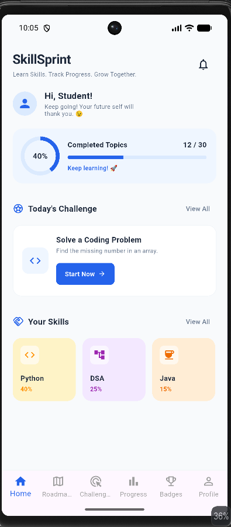
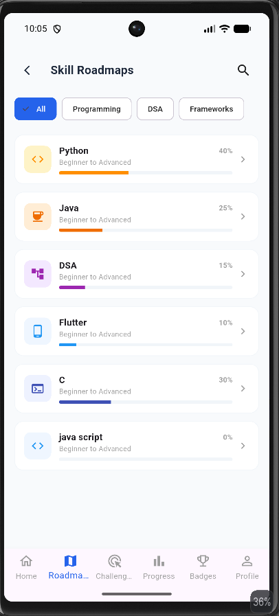
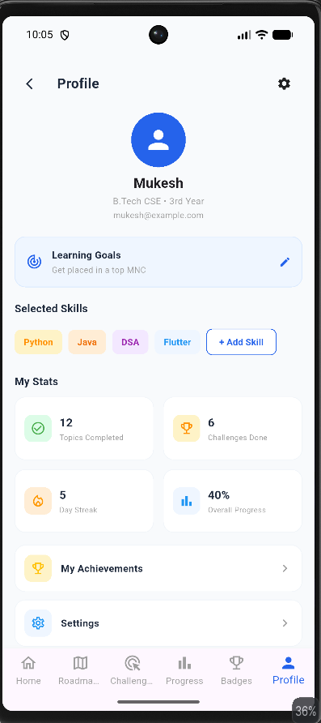

# SkillSprint – Student Skill Development App

## About the Project

SkillSprint is a Flutter-based mobile application designed to help students develop technical skills through structured learning roadmaps. Students can explore different skills, add new skills, and track their learning progress.

## Features

* Explore technical skill roadmaps.
* View Python, Java, DSA, Flutter, and other skills.
* Add custom skills.
* Save added skills locally.
* Track learning progress.
* View skill details.
* Simple and user-friendly interface.

## Technologies Used

* Flutter
* Dart
* Provider
* SharedPreferences
* Android Studio
* Visual Studio Code

## Project Structure

```text
lib/
├── models/
├── providers/
├── screens/
├── services/
├── widgets/
└── main.dart

test/
└── widget_test.dart
```

## How to Run the Project

1. Clone or download this repository.
2. Open the project in VS Code.
3. Run the following command:

```bash
flutter pub get
```

4. Run the application:

```bash
flutter run
```

## Testing

Run the widget tests using:

```bash
flutter test
```

**Test Result:** All tests passed successfully.

## Data Storage

Custom skills are stored locally using SharedPreferences. Added skills remain available after restarting the application.

## Release APK

The release APK is available at:

`build/app/outputs/flutter-apk/app-release.apk`

## Project Details

* **Project Name:** SkillSprint
* **Platform:** Android
* **Framework:** Flutter
* **Project Type:** Academic Group Project
## App Screenshots

### Home Screen


### Roadmap Screen


### Profile Screen
